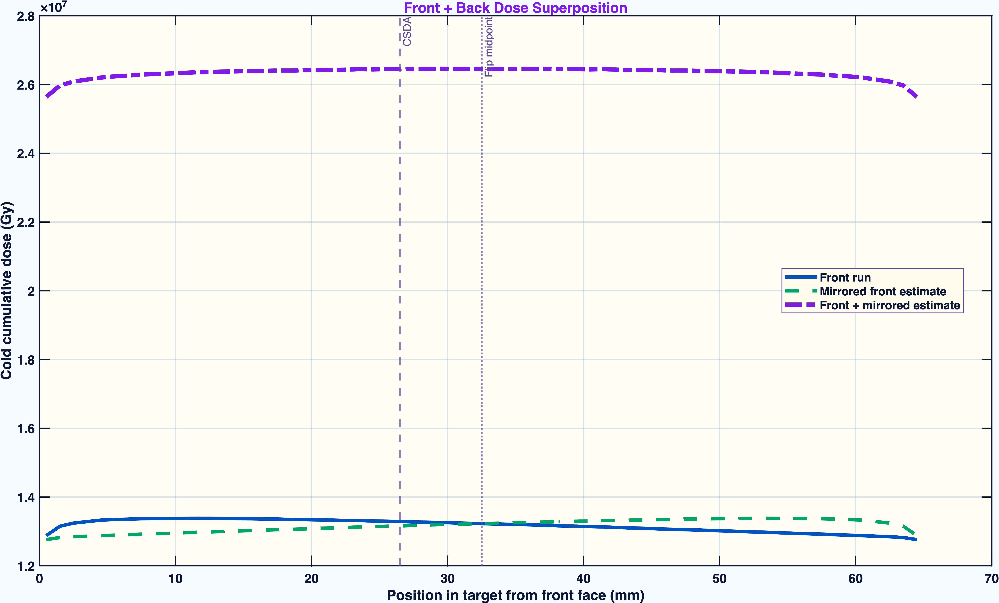

# UITF02: Electron Irradiation of Polarized Ammonia Targets

TOPAS/Geant4 Monte Carlo studies of electron-beam irradiation of solid ammonia
(NH3 and ND3) used to prepare targets for dynamic nuclear polarization (DNP).

**Samuel B. Takwirira**, Nuclear Physics Group, University of New Hampshire.
Advisor: Prof. Karl Slifer. Carried out in collaboration with the Jefferson Lab
Target Group.



## Background

Ammonia targets need radiation-induced paramagnetic centers before DNP can
polarize them. Whether a target is well prepared depends on more than the
delivered charge. It also depends on where the ionization dose lands, how
evenly it covers the target volume, and how much heat a cold irradiation
deposits. These studies use Monte Carlo transport to answer those questions
before beam time.

## Studies

The repository holds two studies. The first developed the methods that the
second used.

| | Study | Period | Setup | Main output |
| --- | --- | --- | --- | --- |
| 1 | [**UNH ammonia irradiation studies**](unh-ammonia-irradiation/) | Dec 2025 – Apr 2026 | 20 MeV e⁻ beam, ND3/NH3 basket in a liquid-argon bath | Parameter-file series, depth-dose and 2D maps, slide decks |
| 2 | [**UITF two-sided DNP irradiation**](uitf-dnp-irradiation/) | May – Jul 2026 | 8 MeV e⁻ at JLab UITF, packed ND3 in a liquid-helium bath, front/back exposure | [Project report](uitf-dnp-irradiation/Project_Report.pdf) and presentation deck |

### 1. UNH Ammonia Irradiation Studies

This study builds up a model of an ammonia target basket inside an aluminum
dewar filled with liquid argon. The model starts with a homogeneous ND3 block
and moves on to a rotating target (TOPAS 4D time features), packed 1 mm NH3
spheres, regular sphere lattices, and finally a voxelized random-sphere
phantom. Dose is scored separately in NH3 and LAr. See the
[study README](unh-ammonia-irradiation/README.md) for how the parameter files
developed over time.

### 2. UITF Two-Sided DNP Irradiation

This study asks whether an 8 MeV electron beam at the Jefferson Lab Upgraded
Injector Test Facility can irradiate a 6.5 cm packed ND3 target from both
sides with a usable dose field and an acceptable cold heat load. Results:

- One-sided exposure does not cover the full 6.5 cm target length.
- Sequential front/back irradiation gives the cumulative dose field the
  proposal needs.
- Cold case (1 uA): about `4.97e15 e-/cm2` per side and `0.064 W` heat load
  per active side.
- Warm case (10 uA): about `9.97e16 e-/cm2` per side and `0.644 W` per active
  side.
- Radical chemistry and the final polarization are outside what TOPAS models
  and need ESR/NMR benchmarks.

See the [study README](uitf-dnp-irradiation/README.md) and the
[project report](uitf-dnp-irradiation/Project_Report.pdf).

## Repository Layout

```
UITF02/
├── unh-ammonia-irradiation/    Study 1: UNH NH3/ND3 irradiation development
│   ├── parameter-files/        TOPAS parameter files, named by date
│   ├── voxel-phantom/          voxel phantom generator and phantom cards
│   ├── beam-check/             beam phase-space validation
│   ├── analysis/               MATLAB plotting scripts
│   ├── results/                scorer CSV outputs
│   ├── logs/  figures/  presentations/  notes/
│   └── README.md
└── uitf-dnp-irradiation/       Study 2: UITF two-sided 8 MeV irradiation
    ├── UITF2-*.txt             TOPAS geometry and production cards
    ├── analyze_DNP_UITF2*.{py,m}
    ├── run_UITF2.command       full pipeline
    ├── UITF_DNP_Output_*/      scorer outputs
    ├── figures_matlab/         report and presentation figures
    ├── outputs/                presentation deck
    ├── Project_Report.pdf
    └── README.md
```

## Software

- [TOPAS](https://www.topasmc.org/) 3.9 (Geant4-based) with
  `g4em-standard_opt4` electromagnetic physics
- MATLAB R2025a for the analysis and figures
- Python 3 with `numpy`, `pandas`, `matplotlib`, and `scipy` (UITF
  single-run analysis and phantom generation)

## Repository History

This repository combines three earlier repositories, and the full commit
history of each is preserved:

- `UITF02`: the UITF study (now `uitf-dnp-irradiation/`)
- `UITF02-EDITS2`: an earlier working copy of the UITF study, merged into the
  same folder
- `TOPAS-UNH`: the UNH studies (now `unh-ammonia-irradiation/`)

To see a file's history from before the move, use
`git log --follow <path>`.
