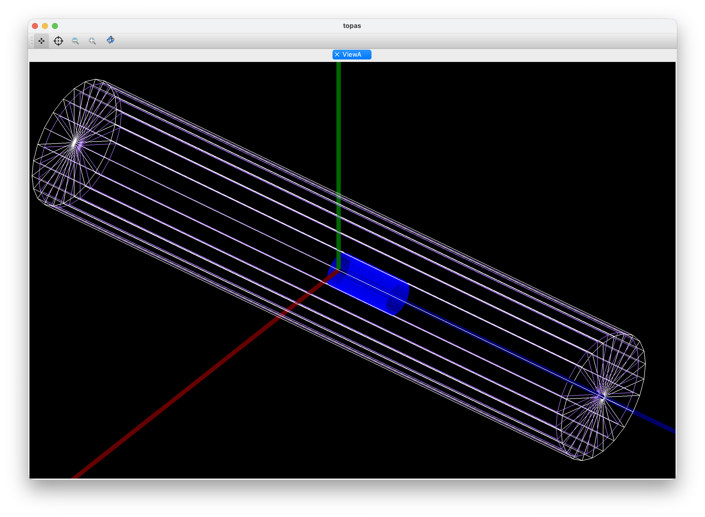

# UNH Ammonia Target Irradiation Studies

TOPAS/Geant4 development studies of electron irradiation of solid ammonia
(ND3 and NH3) for polarized-target preparation, carried out in the UNH Nuclear
Physics Group with Prof. Karl Slifer between December 2025 and April 2026.

These studies built up the geometry, materials, scoring, and analysis approach
that the [UITF two-sided irradiation study](../uitf-dnp-irradiation/) later
used.



## Model

Every parameter file shares the same base setup:

- **Beam:** 20 MeV electrons with 3% energy spread and a Gaussian spot cut off
  at 2 cm.
- **Cryostat:** aluminum dewar (9.2 cm outer radius) filled with a liquid-argon
  bath.
- **Target:** ammonia basket inside the bath, offset 5 cm from the dewar
  center.
- **Physics:** `g4em-standard_opt4` for low-energy electron transport.
- **Scoring:** depth profile of deposited energy (reported as -dE/dz) and 2D
  dose-uniformity maps. From late February on, NH3 and LAr are scored
  separately.

## How the Studies Developed

| Date | Parameter file(s) | What changed |
| --- | --- | --- |
| Jan 21–27 | `2026-01-21_TOPAS_ND3*`, `2026-01-23_TOPAS_ND3*`, `20260127ND3.txt` | Static solid-ND3 box basket in the LAr bath. `_Ge` files are geometry-check variants. |
| Feb 16 | `20260216ND3.txt` | 4D time features added to model target rotation. |
| Feb 23 | `20260223NH3Rot.txt` | Spherical NH3 target rotated 0 to 2π, with accumulated 2D map and depth profile. |
| Feb 23 | `voxel-phantom/20260223NH3-4D.txt` | First voxelized NH3/LAr phantom. |
| Feb 26 | `20260226ND3Rot.txt` | Rotating sphere of homogenized 65% ND3 + 35% LAr. |
| Feb 27 | `20260227NH3Rot.txt`, `20260227NH3RotPi.txt` | Packed 1 mm NH3 spheres (packing fraction ≈ 0.55) in LAr, rotating. |
| Mar 4–8 | `20260304NH3.txt`, `20260308NH3.txt` | Packed-sphere target without rotation, NH3 and LAr scored separately. |
| Mar 23–25 | `20260323NH3.txt`, `20260325NH3.txt` | 1 mm NH3 spheres on a repeated 52 × 52 × 105 lattice. |
| Mar 26 | `voxel-phantom/20260326NH3.txt` | 250 × 250 × 500 voxel phantom (0.2 mm voxels) of randomly placed NH3 spheres in LAr. |

`notes/TO-DOs` lists the open modeling items from this period, such as
deuterium nuclear scattering, cryogenic densities, and LAr scoring.

## Folder Layout

```
unh-ammonia-irradiation/
├── parameter-files/   TOPAS parameter files, named by date
├── voxel-phantom/     generate_phantom.py, phantom.raw, materials.txt and the
│                      two parameter files that load the phantom
├── beam-check/        beam phase-space check (TOPAS card + MATLAB reader)
├── analysis/          MATLAB plotting scripts for depth-dose and 2D maps
├── results/           TOPAS scorer outputs (CSV) and time-feature logs
├── logs/              TOPAS console logs from production runs
├── figures/           geometry screenshots, setup images, exported plots
├── presentations/     slide decks on the NH3 irradiation work (incl. Phys 806)
└── notes/             TO-DO list and an SSH cheat sheet
```

## Running

**TOPAS.** Run a parameter file from the folder you want the CSV output
written to:

```sh
cd parameter-files
topas 20260308NH3.txt
```

The voxel-phantom files load `phantom.raw` by relative path, so run them from
`voxel-phantom/`. To rebuild the phantom (about 31 MB), run
`python3 generate_phantom.py` there. It writes `phantom.raw` and
`materials.txt`. The sphere centers are random, so a rebuilt phantom will not
match the committed one byte for byte.

**MATLAB.** The scripts read CSV files by name from the current folder. Run
them from `results/` with `analysis/` on the path:

```matlab
cd results
addpath ../analysis
Map2D_sup
```

Edit the `filename` line at the top of each script to choose which run to
plot.

**Beam check.** `beam-check/MATLABCompare.m` is a TOPAS parameter file, even
though it has a `.m` extension. It sends the production beam through vacuum
onto a phase-space scorer. `beam-check/BeamTester20270203.m` then reads the
phase-space file and compares the measured mean energy, energy spread, and
spot size against the intended values. The card writes `BeamResults`, so point
the script's `filename` at that output before running it.

## Results Files

CSV names give the material, the quantity, and usually a date stamp, for
example `NH3_DepthDose_0406.csv` or `LAr_Map_032426.csv`. Each file starts
with the TOPAS scorer header, which names the parameter file that produced it
and gives the binning and units. A few results, including the `_0406`
files, came from parameter files that were never committed (for example
`20260406NH3.txt`). Their headers are the only record of which card produced
them.
